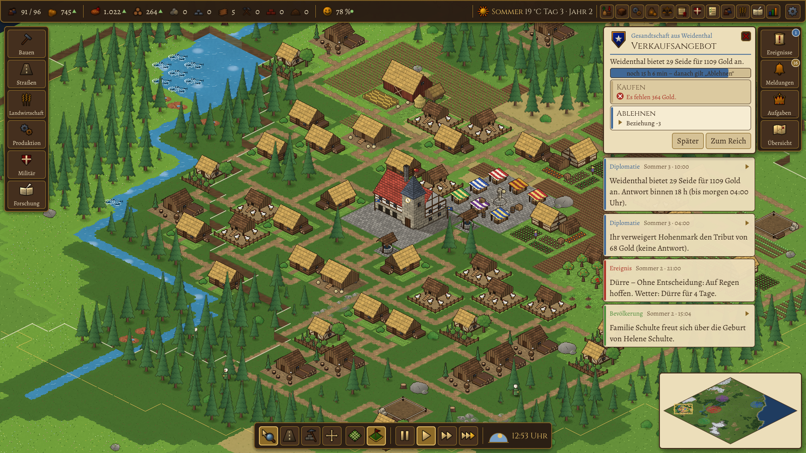

# KINGDOMS – Rise of an Empire

Mittelalterliches Städtebau- und Königreich-Simulationsspiel, vollständig in Rust – mit eigener
modularer Engine auf Basis von **wgpu**, **winit**, **glam** und **egui** (keine fertige Game-Engine).

## Bilder



Alle Grafiken sind **prozedural erzeugte Platzhalter-Grafik** (`tools/assetgen`), keine finale
Kunst; Audio liegt noch nicht bei. Die Bilder stammen aus dem Release-Build in 1600 × 900
(Software-Vulkan unter Xvfb) und zeigen echte Spielzustände, die über die Entwickler-Variablen
(siehe unten) hergestellt wurden.

| Bild | Inhalt |
|---|---|
| [Hauptmenü](docs/screenshots/01_hauptmenue.png) | Hauptmenü mit „Fortsetzen“ und lebender Stadt im Hintergrund |
| [Neues Spiel](docs/screenshots/02_neues_spiel.png) | Seed, Kartengröße, Schwierigkeit, Ereignisse, Szenario und Landschaftsvorschau |
| [Spielstart](docs/screenshots/03_spielstart.png) | Rathaus, zwei Holzhäuser und zwölf Siedler am ersten Morgen (Seed 7) |
| [Stadt im Sommer](docs/screenshots/04_stadt_sommer.png) | Entwickler-Stadt im Sommer des zweiten Jahres mit Markt, Feldern und Höfen; rechts die angedockte Anfragekarte eines Reichs über den Meldungskarten (Überschrift: Art der Meldung) |
| [Winternacht](docs/screenshots/05_stadt_winter_nacht.png) | Dieselbe Stadt in einer verschneiten Winternacht: Schnee auf Dächern und auf der Minikarte, Rauch, beleuchtete Fenster |
| [Reichsverwaltung · Wirtschaft](docs/screenshots/06_reichsverwaltung_wirtschaft.png) | Angebot und Nachfrage je Warengruppe, Engpässe, Überschüsse und Produktionsketten |
| [Forschung](docs/screenshots/07_forschung.png) | Technologiebaum mit laufender und vorgemerkter Forschung |
| [Diplomatie](docs/screenshots/08_diplomatie.png) | Anfragen der Reiche, Beziehungen (Balken mit Skala −100 … +100) und Handlungen |
| [Kampf am Mauerring](docs/screenshots/09_militaer_kampf.png) | Das Heer von Hohenmark (karminrot, Beschriftung über der Gruppe) hat ein Tor des geschlossenen Mauerrings durchbrochen; das Tor brennt, Verteidiger kämpfen davor (Seed 31, `KINGDOMS_DEV_WALLS`) |
| [Handel und Karawanen](docs/screenshots/10_handel_karawane.png) | Reiter Handel: Handelsaufträge mit geöffneter Bearbeitung, Karawanen unterwegs und Handelspartner |
| [Ereignis](docs/screenshots/11_ereignis.png) | Entscheidungskarte „Brand“ mit Brandherd, Frist und vorhergesagter Wirkung jeder Wahl |
| [Bürgerfenster](docs/screenshots/12_buerger.png) | Eine Marktfrau mit Familie, Freunden, Ersparnissen, Arbeit und Zufriedenheit |
| [Ausbau](docs/screenshots/13_ausbau.png) | Sägewerk im Ausbau zum Großen Sägewerk, wartet auf Baumaterial |
| [Einstellungen](docs/screenshots/14_einstellungen.png) | Lautstärken der sechs Kanäle (ohne Audiogerät mit Hinweis) |
| [Spielstände](docs/screenshots/15_spielstaende.png) | Spielstand-Liste, nach Spiel gruppiert, mit allen Angaben |
| [Fest ausrichten](docs/screenshots/16_fest_ausrichten.png) | Reiter Bevölkerung: Kosten und Wirkungen eines Fests, Knopf „Fest ausrichten“ |
| [Winter und Minikarte](docs/screenshots/17_winter_minikarte.png) | Die Entwickler-Stadt an einem verschneiten Wintervormittag aus der Ferne, es schneit; die Minikarte zeigt die Schneedecke (Wälder mit dunklen Kronen, offene Gewässer, Land außerhalb des eigenen Gebiets abgedunkelt) und die Gebiete der Nachbarreiche |

## Starten

Voraussetzung: Rust (stable, ≥ 1.85). Auf macOS (Apple Silicon) läuft das Spiel über Metal,
auf Windows über DirectX 12/Vulkan, auf Linux über Vulkan.

```bash
cargo run --release
```

Das Spiel öffnet mit dem **Hauptmenü** (die Grafiken werden dabei im Hintergrund geladen).
`KINGDOMS_DEBUG=1` blendet das Debug-Overlay ein, `RUST_LOG=debug` schreibt ein ausführliches
Log. Entwickler- und Testvariablen wie `KINGDOMS_SEED=<zahl>` starten direkt ein Spiel (siehe
unten). Einstellungen, Spielstände, Logs und Screenshots liegen im Benutzerverzeichnis
(Linux: `~/.local/share/kingdoms`, macOS: `~/Library/Application Support/Kingdoms`, Windows:
`%APPDATA%\Kingdoms`).

## Auf dem Mac spielen (Apple Silicon)

Das Spiel ist für macOS auf Apple Silicon (M1 und neuer) gedacht und läuft dort über Metal.

**Voraussetzungen**
* macOS 11 (Big Sur) oder neuer.
* Die Xcode-Befehlszeilenwerkzeuge (Linker, `codesign`, `sips`, `iconutil`):
  `xcode-select --install`.
* Rust über rustup: `curl --proto '=https' --tlsv1.2 -sSf https://sh.rustup.rs | sh`, danach ein
  neues Terminal (oder `source "$HOME/.cargo/env"`). Ein Apple-Silicon-Mac baut mit der
  Standard-Toolchain direkt für `aarch64-apple-darwin`.

**Bauen und starten** (im Ordner des Projekts):
```bash
cargo run --release
```

**Als App (Kingdoms.app)** – zum Starten aus dem Finder oder Dock:
```bash
tools/macos/make_app.sh            # baut die Release-Version und legt target/macos/Kingdoms.app an
open target/macos/Kingdoms.app     # oder die App in den Programme-Ordner ziehen
```
Das Skript baut mit `cargo build --release`, legt die Grafiken und Spieldaten (`assets/`, `data/`)
in `Contents/Resources` (das Spiel sucht dort zuerst), schreibt die `Info.plist` (Version aus
`Cargo.toml`, Retina-fähig, ab macOS 11, Kategorie Strategiespiele), erzeugt das App-Symbol
`Kingdoms.icns` aus `assets/app_icon.png` und signiert die App ad hoc (`codesign --sign -`), was
Apple Silicon für jedes Programm verlangt. Optionen: `--target aarch64-apple-darwin` bzw.
`x86_64-apple-darwin`, `--universal` (beide Architekturen in einer App; vorher
`rustup target add aarch64-apple-darwin x86_64-apple-darwin`), `--out <ordner>`, `--no-build`.
Eine selbst gebaute App startet auf diesem Mac ohne Rückfrage; auf einen anderen Mac kopiert,
blockiert Gatekeeper sie als „nicht verifiziert“ – dort Rechtsklick → „Öffnen“ oder
`xattr -dr com.apple.quarantine Kingdoms.app`.

**Speicherorte:** Einstellungen (`settings.ron`, `engine.ron`), Spielstände (`saves/`), Logs
(`logs/`) und Screenshots (`screenshots/`) liegen in `~/Library/Application Support/Kingdoms`
(im Finder: Gehe zu → Gehe zum Ordner …). Spielstände sind zwischen Mac, Linux und Windows
austauschbar.

**Bedienung auf dem Mac:** Cmd+S speichert schnell, Cmd+L lädt schnell, Cmd+P macht einen
Screenshot, Cmd+D zeigt das Debug-Overlay, die Rückschritt-Taste ⌫ wählt den Abriss (die F-Tasten
und Entf gehen weiterhin, mit fn); Cmd+Q beendet
mit derselben Rückfrage wie das Schließen des Fensters, Cmd+H blendet aus, Cmd+M minimiert. Auf
dem Trackpad verschiebt Wischen mit zwei Fingern die Karte, Zusammenziehen und Spreizen zoomt; wer
lieber mit dem Wischen zoomt (wie mit dem Mausrad), schaltet „Trackpad: Wischen mit zwei Fingern
verschiebt die Karte“ unter Einstellungen → Spiel → Kamera aus. Ziehen mit gedrückter rechter
Taste (Klick mit zwei Fingern) verschiebt die Karte ebenfalls. Auf Retina-Bildschirmen zeichnet
das Spiel in voller Auflösung; die Oberfläche richtet sich nach der Skalierung von macOS.

**Bekannte Einschränkungen:** In dieser Entwicklungsumgebung gibt es keinen Mac – das Spiel wurde
auf macOS **nicht** gebaut oder gestartet. Der plattformabhängige Code (Pfade, Bundle-Suche,
Cmd-Tasten, Trackpad, Retina, Metal-Auswahl, Audio über CoreAudio) ist geprüft und, wo möglich,
unter Linux getestet; das Skript ist unter Linux nur auf Syntax und den Aufbau der App (ohne
Symbol und Signatur) geprüft. Melde bitte, was auf dem Mac nicht stimmt (mit dem Log aus
`~/Library/Application Support/Kingdoms/logs`). Audio bleibt stumm, bis die Audiodateien
geliefert sind (siehe `assets/audio/README.md`).

## Hauptmenü

Hinter dem Menü lebt eine kleine Stadt (eigene Simulation, die Kamera zieht langsam darüber).

* **Fortsetzen** lädt den neuesten ladbaren Spielstand (Name und Zeit stehen darunter).
* **Neues Spiel:** Welt-Seed (Zahl oder beliebiger Text, „Zufällig“ würfelt einen), Kartengröße
  (Klein 128 × 128 bis Riesig 384 × 384 Felder), Schwierigkeit (Häufigkeit der Zufallsereignisse),
  Zufallsereignisse an/aus, Szenario (Auswahl, sobald es mehrere gibt). Rechts eine Vorschau der
  Landschaft genau dieses Seeds mit Startplatz, Wasser-, Wald- und Gebirgsanteil und den Vorkommen
  am Start. „Spiel starten“ erzeugt die Welt im Hintergrund hinter einem Ladebildschirm.
* **Spiel laden**, **Einstellungen**, **Credits** (verwendete Bibliotheken mit Lizenzen, Schriften,
  Stand von Grafik und Audio), **Beenden**.

Bedienung mit Maus oder Tastatur: Pfeiltasten bzw. W/S wählen, Eingabe öffnet, Esc geht zurück.

## Spielstände

* **Pausenmenü** (Esc oder Knopf oben rechts): Fortsetzen, Speichern …, Laden …, Einstellungen,
  Hauptmenü, Beenden; darunter Schnellspeichern/-laden und wie viel Spielzeit ungespeichert ist.
  Hauptmenü, Beenden und das Schließen des Fensters fragen nach, wenn seit dem letzten Speichern
  Spielzeit vergangen ist („Speichern …“, „Ohne Speichern verlassen“, „Abbrechen“).
  Ist das Spiel verloren (Hauptquartier erobert oder niemand mehr im Reich), öffnet es sich als
  „Niederlage“ mit dem Grund; die Zeit steht dann still, „Reich ansehen“ schließt es.
* **Speichern …:** Name eingeben (oder einen vorhandenen Spielstand anklicken); ein vorhandener
  Name wird erst nach Rückfrage überschrieben. Gespeichert wird im Hintergrund, das Spiel läuft
  ohne Stocken weiter.
* **Laden:** Liste aller Spielstände, neueste zuerst, mit Name, Datum und Uhrzeit, Spieldatum,
  Einwohnern, Gold, Gebäuden, Szenario, Kartengröße, Schwierigkeit, Seed, Spielzeit, Format,
  Version und Dateigröße. Spielstände, die nicht passen (anderes Format, andere Spieldaten,
  beschädigt), sind markiert und nennen den Grund. Doppelklick oder Eingabe lädt, Entf löscht
  (nach Rückfrage).
* **Automatisch** speichert das Spiel nach der Einstellung (Standard: alle 10 Minuten laufender
  Spielzeit; auch je 1, 3 oder 7 Spieltage oder aus) reihum in drei Plätze
  `autosave_1` … `autosave_3`; F5/F9 nutzen den Schnellspielstand.
* Dateien: `saves/<name>.ksav` (Spielzustand, Format der Simulation mit Prüfsumme) und
  `saves/<name>.kmeta` (Angaben für die Liste und die letzten 200 Meldungen, die nach dem Laden
  wieder unter „Meldungen“ stehen). Geschrieben wird erst in eine temporäre Datei, die
  auf den Datenträger geschrieben wird; der alte Stand bleibt als `.bak` erhalten, bis der neue
  geprüft an seinem Platz liegt. Beim Laden werden Version, Prüfsumme, Spieldaten und
  Spielzustand geprüft; Fehler erscheinen als deutscher Hinweis, das Spiel stürzt nicht ab und
  setzt nach dem Laden exakt dort fort, wo gespeichert wurde.

## Einstellungen

Im Hauptmenü und im Pausenmenü; jede Änderung wirkt sofort, gespeichert wird beim Schließen.

| Reiter | Inhalt |
|---|---|
| Audio | Gesamt, Musik, Umgebung, Effekte, Oberfläche, Stimmen (je 0–100 %), Stumm |
| Grafik | Vollbild, vertikale Synchronisation, Bildratenbegrenzung, Kantenglättung (4× MSAA), Größe der Oberfläche (die Oberfläche braucht 1280 × 720 Punkte: ist das Fenster dafür zu klein, wirkt eine kleinere Größe, das Menü nennt sie), Partikeldichte, Tag und Nacht |
| Spiel | automatisches Speichern, automatisch anhalten (Ereignis mit Entscheidung, Gefahrenmeldung), Bildschirmrand-Scrollen, Kamerageschwindigkeit, Meldungsfilter |
| Steuerung | alle Tastenbelegungen (je bis zu zwei, auch mit Strg/Alt/Shift); eine schon vergebene Taste wird erst nach Rückfrage umgezogen; Rechtsklick entfernt, „Standard“ setzt zurück |

Gespeichert wird in `settings.ron` (Spiel, Darstellung, Tasten) und `engine.ron` (Fenster, Grafik,
Lautstärken) im Benutzerverzeichnis; fehlende oder fehlerhafte Einträge fallen auf die
Standardwerte zurück.

## Bildschirm

* **Oben:** Bevölkerung (Bewohner / Wohnraum), Gold (Pfeil = Tagesbilanz), Nahrung, Holz, Stein,
  Eisen, bei genug Platz weitere Waren (Bretter, Werkzeuge, Ziegel, Lehm), Zufriedenheit,
  Jahreszeit und Datum; rechts die Knöpfe der Reichsverwaltung und das Menü. Tooltips nennen
  Bestand, Erzeugung, Verbrauch und Faktoren.
* **Links:** Bauen (Wohnhäuser, öffentliche Gebäude und Lager), Straßen (mit Mauern und Toren),
  Landwirtschaft, Produktion, Militär – jeder Knopf öffnet die Bauleiste dieser Kategorie
  daneben – und Forschung (Reichsverwaltung, Reiter Forschung). Die Militär-Leiste beginnt mit
  „Heer verwalten“ (Soldaten, Kompanien, Feinde im Anmarsch) und „Diplomatie“ (Kriege, Anfragen),
  darunter die Militärgebäude zum Bauen.
* **Rechts:** Ereignisse (blinkt rot, solange eine Entscheidung offen ist; öffnet die
  Entscheidung, sonst diplomatische Anfragen, Wirkungen und Verlauf; ein blauer Zähler nennt
  offene Anfragen), Meldungen (alle Benachrichtigungen der Sitzung, Auswahl „Art“, Zähler für neue), Aufgaben
  (Herrscherrang, Ansehen, Wohlstand, die Anforderungen des nächsten Rangs mit Fortschritt und
  die erreichten Ränge; ein Balken am Knopf zeigt den Fortschritt), Übersicht (Bevölkerung,
  Zufriedenheit, Schatz und Tagesbilanz, Nahrung mit Reichweite, Forschung, Herrscherrang,
  Gefahren – Kriege, Feinde mit Ankunftszeit, Anfragen, Sold, Geld, Nahrung –, letzte Ereignisse;
  jede Zeile öffnet das passende Fenster oder springt zum Ort). Daneben das Info-Fenster der
  Auswahl; neue Meldungen erscheinen als Karten links davon (Überschrift: Art der Meldung, bei allgemeinen Meldungen die Schwere).
* **Feinde:** Räuberbanden und feindliche Heere zeigen rote Marken am Bildschirmrand (Art, Größe,
  Ankunftszeit bzw. „Greift an“/„Auf der Flucht“, Pfeil zur Richtung); ein Klick springt hin. Auf
  der Minikarte pulsieren sie rot, eigene Kompanien sind goldene, Karawanen farbige Punkte.
* **Unten:** Auswählen, Straße bauen (zuletzt genutzter Typ), Abreißen, Versetzen, Raster,
  Gebietsgrenze · Pause, 1×, 2×, 4× · Tageszeit (Sonne bzw. Mond auf dem Bogen, Uhrzeit).
  Rechts unten die Minikarte.
* **Ereignis-Entscheidung:** Ein neues Ereignis öffnet eine Karte in der Bildmitte mit Text,
  betroffenem Gebäude („zeigen“), Frist bis zur Standardwahl und den Wahlmöglichkeiten samt
  vorhergesagter Wirkung (nicht mögliche mit Grund). „Später entscheiden“ oder Esc blendet sie
  aus, E holt sie zurück. Ist „automatisch anhalten bei Ereignissen“ eingestellt, läuft das Spiel
  nach der Entscheidung im vorherigen Tempo weiter.
* **Forschung** (U): Technologiebaum nach Bereichen (Landwirtschaft, Architektur, Handwerk,
  Bergbau, Handel, Medizin, Militär, Verwaltung) mit Verbindungen zu den Voraussetzungen, Zustand
  (erforscht, in Arbeit, vorgemerkt mit Platz und Restzeit, verfügbar, gesperrt), Kosten und
  Fortschritt. Klick zeigt Beschreibung, Wirkungen,
  Kosten, Dauer, Voraussetzungen und was die Technologie ermöglicht; Doppelklick oder „Einreihen“
  reiht ein (gesperrte mit ihren fehlenden Voraussetzungen davor – in einem Schritt, ganz oder
  gar nicht). Rechts die Forschungsliste
  (nach vorn/hinten, entfernen), Forschungsquellen und Punkte je Tag. Ungültige Änderungen lehnt
  die Simulation mit deutschem Hinweis ab.
* **Reichsverwaltung:** Die Reiter stehen in zwei Zeilen mit Gruppen – „Wirtschaft“ (Lager,
  Produktion, Wirtschaft, Finanzen, Handel), „Volk“ (Arbeit, Bevölkerung, Landwirtschaft) und
  „Reich“ (Forschung, Diplomatie, Militär, Statistik) –, jeder mit Symbol und Namen.
* **Wirtschaft** (O): Angebot und Nachfrage je Warengruppe, Warenwert, Preisindex,
  Handelsbilanz je Tag, Engpässe und Überschüsse (Klick öffnet den Verlauf der Ware), Zustand der
  Produktionsketten mit Ertrag minus Kosten je Tag (Klick zeigt den ersten Betrieb mit Problem).
  Das Info-Fenster eines Betriebs nennt seine **Wirtschaftlichkeit**: Wert der Erzeugnisse gegen
  Rohstoffe, Werkzeugverschleiß, Löhne und Unterhalt je Tag zu heutigen Preisen und die
  Herstellkosten je Einheit neben dem Marktpreis; Feldfarmen und Obstgärten werden nach ihren
  Ernten der letzten Tage bewertet. Darunter steht, was der Betrieb **gemessen** hergestellt hat
  („Gestern 83 % des Möglichen“, gestern und heute bisher, Mittel der letzten Tage); der Reiter
  **Produktion** (P) zeigt das in der Spalte „Gestern“ für alle Betriebe.
* **Feste und Hofhaltung:** Im Reiter **Bevölkerung** (V) richtet „Fest ausrichten“ ein Fest aus
  (100 Gold und 4 Gold je Einwohner, Kirche oder Marktplatz nötig, höchstens alle 12 Tage): ein
  Festtag, Zufriedenheit +8 für 6 Tage und Gesandte der Reiche im Frieden als Gäste. Der Kasten
  nennt Kosten und Wirkungen; geht es gerade nicht, ist der Knopf gesperrt und der Grund steht
  darunter (z. B. „Das nächste Fest ist in 10 Tagen möglich“). Der Reiter **Finanzen** (F) zeigt
  unter „Hof und Feste“ die Hofhaltung Eures Rangs (ab der Stadt, im Unterhalt enthalten) und den
  nächsten teureren Rang.
* **Statistik** (C): Verläufe von Bevölkerung, Schatzkammer, Nahrung, einer Ware, Zufriedenheit,
  Beschäftigung, **Wohlstand** (Ersparnisse aller Haushalte und je Haushalt) sowie Gebiet und
  Bauten – über die letzten Tage, die letzten 72 Stunden oder „Jahreszeiten (gesamt)“: ein Wert
  am Ende jeder Jahreszeit über das ganze Spiel, im Tooltip mit Eurem damaligen Rang.
* **Landwirtschaft & Wetter** (N): zusätzlich der Wind (Richtung, aus der er weht, und Stärke) –
  derselbe, der Bäume, Felder, Rauch und Regen neigt und Brände weiterträgt –, wer das Wetter
  gerade vorgibt („Wetter vom Ereignis „Dürre“ vorgegeben (noch 4 Tage)“), der Wintervorrat als
  „Vorrat · Bedarf im Winter“ und der Zustand der bestellten Felder (Stürme, Dürre und Welken
  senken ihn; daran hängen die Ernte-Ereignisse im Herbst).
* **Handel** (K): die Handelsbilanz (Aus- und Einfuhr heute, Mittel der letzten Tage, Verlauf je
  Tag), außer den Aufträgen die Karawanen unterwegs (fremde Händler und eigene, mit
  Stand, Restzeit, Fracht, Gold, Überfallrisiko, „Kamera hin“), die Reiche als Handelspartner mit
  Einkaufs- und Verkaufspreis je Ware und „Karawane aussenden …“: Waren zum Verkauf, Gold für
  Einkäufe und Wünsche wählen; die Simulation prüft live, ob es geht (Kontor, Zugang, höchstens
  drei eigene Karawanen, Traglast, Bestand).

## Diplomatie (I)

* Links die Königreiche mit Wappen, Zustand (feindlich … verbündet, „Im Krieg“) und Beziehung;
  rechts das gewählte Reich: Herrscher und Wesen, Beziehung als Balken mit allen Anteilen,
  Krieg mit Kriegsmüdigkeit, Verträge mit Restlaufzeit, Einwohner, Stärke im Vergleich zu Euch,
  Wohlstand, Gebiet, Karawanenrisiko, gesuchte und angebotene Waren mit Euren Preisen,
  „Kamera hin“ zum Sitz des Reiches und der Verlauf mit diesem Reich.
* **Handlungen:** Verträge vorschlagen oder kündigen, Geschenk, Tribut fordern, Krieg erklären,
  Frieden (ohne Bedingungen, gegen Entschädigung, gegen Gebiet, erkauft). Jede Zeile nennt die
  Kosten bzw. Folgen und, was das Reich jetzt antworten würde („Würde zustimmen/ablehnen“ mit
  den stärksten Gründen) oder warum es nicht geht. Geschenke (Gold und Waren), Forderungen und
  Frieden mit Gold öffnen einen Dialog für den Betrag; Krieg und Kündigung fragen nach.
* **Anfragen** der Reiche (Verträge, Tribut, Kauf- und Verkaufsangebote, Frieden) erscheinen
  auf einer kompakten Karte rechts über den Meldungen (die Bildmitte bleibt frei) mit Wappen,
  Frist und den Folgen beider Antworten; mehrere Anfragen teilen sich die Karte („1 von 3“, Vor
  und Zurück), nach einer Antwort folgt die nächste. „Später“ blendet die Karte bis zur nächsten
  neuen Anfrage aus; alle offenen Anfragen stehen oben im Reiter und unter „Ereignisse“.
  Ereignis-Entscheidungen haben Vorrang. Ohne Antwort gilt eine Anfrage nach Fristende als
  abgelehnt.

## Militär (Q)

* Soldaten, Bereite, Rekruten, Feldzug, Verwundete, Sold je Tag und Stärke; Bedrohungen mit
  Zusammensetzung, Ankunftszeit, Ziel und „Kamera hin“; Kriege mit Kriegsmüdigkeit
  (Knopf „Diplomatie“); Einheiten nach Typ mit Gesundheit, Moral und Ausrüstung.
* **Kompanien:** Werte, Mitglieder (Klick öffnet das Bürgerfenster, „Herauslösen“) und Befehle:
  Bereitschaft, Verteidigen …, Patrouille …, Rückzug, Auflösen, Feldzug bzw. Belagerung gegen
  ein Reich im Krieg. Bereite Soldaten ohne Kompanie lassen sich abhaken und zu einer neuen oder
  bestehenden Kompanie zusammenfassen oder entlassen.
* **Befehle auf der Karte:** „Verteidigen …“ und „Patrouille …“ schließen das Fenster; ein Banner
  oben erklärt den Schritt. Verteidigen: Klick auf ein Gebäude (Besatzung) oder einen Ort (Gebiet
  im eingestellten Umkreis, Vorschau als Quadrat). Patrouille: jeder Klick setzt einen Wegpunkt
  (gepunktete Route mit Rückweg), Eingabe, „Fertig“ oder ein Klick auf den ersten Punkt gibt den
  Befehl, Rechtsklick/Esc nimmt den letzten Punkt zurück. Danach öffnet sich das Fenster wieder;
  solange es offen ist, zeigt die Karte alle Routen und Gebiete der Kompanien.
* **Rekrutierung:** je Militärgebäude (auch im Info-Fenster der Kaserne, des
  Bogenschützenpostens und der Stallungen) die Einheiten mit Kosten, Werten, Sold und
  Ausbildungszeit, „1 ausbilden“ bzw. so viele wie möglich, sonst der Grund; darunter die Rekruten
  in Ausbildung mit Fortschritt. Verteidigungsgebäude nennen Besatzung, Schüsse und Trefferpunkte.
* Feldzüge mit Stand und Restzeit, Kampfberichte (Klick springt zum Ort).
* **Auf der Karte:** eigene Soldaten stehen auf goldenen Ringen, die erste Figur jeder Kompanie
  trägt ein goldenes Banner; Heere fremder Reiche sind in deren Farbe getönt und tragen ihr
  Banner, Räuber sind dunkle Gestalten mit Äxten auf roten Ringen; Händler mit Karren tragen das
  Banner ihres Reiches. Kämpfer, die gerade zuschlagen oder schießen, zeigen ihren Angriff
  (Speerstoß, gespannter Bogen, Schwerthieb, Axt, Katapultwurf); Pfeile von Schützen, Türmen und
  Bogenschützenposten und die Steine der Belagerungsgeräte fliegen sichtbar zum Ziel. Im
  Nahkampf wendet sich jeder Angreifer seinem Ziel zu, Funken und Staub stieben genau zwischen
  den Kämpfenden oder an der Stelle des Tors, der Mauer oder des Gebäudes, auf die ein Feind
  einschlägt; angegriffene Gebäude brennen. Der Reiter Militär zeigt je Feldzug, wie viel
  Proviant noch übrig ist – was beim Heimkehren übrig ist, kommt ins Lager zurück.
  Die Siedlungen der Reiche stehen auf der Karte, ihre Grenzen sind farbige Linien über einem
  getönten Randstreifen (auch auf der Minikarte).
* **Aufstieg und Niederlage:** Ein neuer Herrscherrang öffnet eine Feier (Fanfare, Ansehen,
  nächstes Ziel). Ist das Spiel verloren, zeigt der Niederlage-Bildschirm Grund, Datum und eine
  kurze Bilanz (Regierungszeit, höchster Rang, Bewohner, Gebäude, Schatz, Schlachten, Kriege)
  mit „Spielstand laden“, „Hauptmenü“, „Reich ansehen“ (Esc öffnet ihn wieder) und „Beenden“.

## Steuerung (aktueller Stand)

| Taste / Maus | Funktion |
|---|---|
| W A S D / Pfeiltasten, Bildschirmrand | Kamera bewegen (Shift = schneller) |
| Mausrad, + / − | Zoomen (am Cursor) |
| Trackpad: zwei Finger zusammenziehen/spreizen | Zoomen (am Cursor) |
| Trackpad: mit zwei Fingern wischen | Karte verschieben (Standard auf dem Mac) bzw. zoomen wie das Mausrad (Einstellungen → Spiel → Kamera) |
| Mittlere/rechte Maustaste ziehen | Kamera verschieben |
| Klick auf die Minikarte (unten rechts), ziehen | Kamera dorthin verschieben |
| Leertaste · 1 · 2 · 3 | Pause · Normal · 2× · 4× (auch über die Knöpfe unten) |
| Linksklick | Gebäude bzw. Feld auswählen (Info-Fenster rechts); ein Bewohner vor dem Gebäude hat Vorrang und öffnet das Bürgerfenster |
| Bürgerfenster: Folgen · Zeigen · Zuhause · Arbeitsplatz | Kamera folgt dem Bürger (Verschieben der Karte, Esc oder Schließen beenden das Folgen; Zoomen nicht) · einmal hinschauen · Haus bzw. Arbeitsplatz auswählen; Namen von Verwandten öffnen deren Fenster |
| B | Bauleiste der zuletzt gewählten Kategorie ein-/ausblenden (Kategorien über die Leiste links) |
| Linksklick (Bauwerkzeug) | Gebäude platzieren; mit gedrückter Shift-Taste weiterbauen |
| R · Shift + Mausrad | Gebäude drehen (Bauen und Versetzen) |
| Linke Maustaste ziehen (Straßenwerkzeug) | Straße planen, Loslassen baut |
| Entf / X | Abriss-Werkzeug: Gebäude anklicken, Straßen anklicken oder ziehen |
| M | Versetzen: ausgewähltes Gebäude aufnehmen (oder Gebäude anklicken), dann neu platzieren |
| Rechtsklick · Esc | Schritt abbrechen (Ziehen → Werkzeug → Auswahl); Esc ohne Auswahl öffnet das Menü |
| F5 · F9 | Schnellspeichern · Schnellladen (auch im Pausenmenü) |
| O · L · P · F · K · I · Q · J · V · N · U · C | Reichsverwaltung: Wirtschaft (Ökonomie) · Lager & Waren · Produktion · Finanzen · Handel · Diplomatie · Militär (Quartiere) · Arbeitskräfte (Jobs) · Bevölkerung (Volk) · Landwirtschaft & Wetter (Natur) · Forschung (Universität) · Statistik (Chronik); dieselbe Taste schließt das Fenster wieder (auch über die Knöpfe oben rechts neben dem Datum) |
| Eingabe | Patrouille: Befehl mit den gesetzten Wegpunkten geben |
| E | Ereignis-Entscheidung zeigen/ausblenden (ohne offene Entscheidung: Ereignisse mit Wirkungen und Verlauf) |
| Esc | schließt von innen nach außen: Werkzeugschritt, Folgen, Ereignis-Entscheidung, Seitenfenster bzw. Bauleiste, Reichsverwaltung, Bürgerfenster, Auswahl, sonst Pausenmenü |
| Klick auf eine Zeile der Reichsverwaltung | Betrieb, Lager, Haus oder Farm auswählen und hinschauen; Waren öffnen ihren Verlauf in der Statistik; Bürger (Bevölkerung) und Bewohner (Info-Fenster eines Hauses) öffnen das Bürgerfenster |
| Klick auf eine Meldung (Karte rechts oder Liste „Meldungen“) | wählt das Gebäude der Meldung aus und zeigt es, solange es steht; sonst springt die Kamera zum Ort der Meldung |
| G | Raster ein/aus |
| T | Gebietsgrenze ein/aus |
| H / Pos1 | Zum Rathaus springen |
| F3 | Debug-Overlay |
| F12 | Screenshot |
| Mac: Cmd+S · Cmd+L · Cmd+P · Cmd+D · ⌫ | zusätzlich zu F5 · F9 · F12 · F3 · Entf (die F-Tasten und Entf brauchen auf Mac-Tastaturen die fn-Taste) |
| Mac: Cmd+Q · Cmd+H · Cmd+M | Beenden (mit derselben Rückfrage wie das Schließen des Fensters) · Ausblenden · Minimieren |

Alle Tasten lassen sich unter Einstellungen → Steuerung neu belegen; die Tabelle nennt die
Standardbelegung. Mauszeiger über der Oberfläche wirkt nie auf die Karte. Tooltips im Baumenü und an der Karte
nennen Kosten, Gründe und Tastenkürzel; über einem Bewohner zeigt der Tooltip Name und Tätigkeit.

Auf der Karte laufen die Bewohner, Träger (mit der getragenen Ware), Bauarbeiter und Bauern der
Simulation (Sammler mit dem Werkzeug ihres Betriebs: Holzfäller mit der Axt, Steinbrecher mit der
Spitzhacke, Lehm- und Sandgräber und Förster mit dem Spaten, Fischer mit der Angel; Bergleute
arbeiten im Stollen); die Tageszeit färbt die Welt (Morgendämmerung, Tag, Abendsonne, Nacht, im Winter
kürzere Tage), nachts leuchten die Fenster bewohnter Häuser und arbeitender Werkstätten.

## Projektstruktur

```
crates/engine   eigene Engine (Lifecycle, Loop, Input, Renderer, Kamera, Assets, Debug)
crates/sim      deterministische Simulation (Welt, Wirtschaft, Bevölkerung, …) ohne Grafik
src/            Spiel (Szenen, Darstellung, UI)
tools/assetgen  Generator für Platzhalter-Grafiken
tools/macos     make_app.sh baut das App-Bundle Kingdoms.app (siehe „Auf dem Mac spielen“)
assets/ data/   Grafiken (Atlanten)/Audio/Schriften bzw. Spieldaten (RON); assets/README.md
docs/           Architektur, Game Design, Roadmap, Fortschritt, Asset-Konventionen, Bilder (screenshots/)
tests/          nur ein Wegweiser: Integrationstests in crates/sim/tests, Unit-Tests je Crate
```

## Entwicklung

```bash
cargo test --workspace                 # alle Tests
cargo clippy --workspace --all-targets # Lints
cargo run -p kingdoms_assetgen --release -- assets   # Platzhalter-Atlanten neu erzeugen
cargo run -p kingdoms_sim --release --example worldmap -- <seed> medium world.ppm  # Weltübersicht
```

### Entwickler-Optionen (Umgebungsvariablen)

Jede der folgenden Spielvariablen (`KINGDOMS_SEED`, `KINGDOMS_WORLD_SIZE`, `KINGDOMS_WARP_TICKS`,
`KINGDOMS_DEV_*`, `KINGDOMS_FOCUS`, `KINGDOMS_ZOOM`, `KINGDOMS_SELECT`, `KINGDOMS_TOOL`,
`KINGDOMS_CURSOR`, `KINGDOMS_MENU`, `KINGDOMS_SPEED`, `KINGDOMS_WINDOW`, `KINGDOMS_PANEL`,
`KINGDOMS_QUICK`; auch `KINGDOMS_DEV_ARMY`, `KINGDOMS_DEV_WALLS`, `KINGDOMS_DEV_THREAT`, `KINGDOMS_DEV_TRADE`, `KINGDOMS_DEV_UPGRADE`, `KINGDOMS_DEV_CASE`)
startet direkt ein Spiel statt des Hauptmenüs, damit Skripte wie bisher laufen.

| Variable | Wirkung |
|---|---|
| `KINGDOMS_START=menu\|game` | erzwingt das Hauptmenü bzw. den direkten Spielstart (Vorrang vor der Regel oben) |
| `KINGDOMS_SEED=<zahl>` · `KINGDOMS_WORLD_SIZE=small\|medium\|large\|huge` | Welt-Seed (Standard 7) und Kartengröße (Standard `medium`) des direkt gestarteten Spiels |
| `KINGDOMS_WARP_TICKS=<n>` | führt direkt nach dem Spielstart `n` Simulations-Ticks aus (200 Ticks = 1 Spielstunde, 4800 = 1 Tag), z. B. für Screenshots eines entwickelten Zustands |
| `KINGDOMS_DEV_SETTLEMENT=1` | legt um das Rathaus eine kleine Test-Siedlung an – ausschließlich über echte Kommandos (`PlaceBuilding`, danach `BuildRoad`), soweit das Startbudget reicht: Sägewerke (2×3) in mehreren Drehungen, Holzfäller, Förster, ein Gebäude an einer Geländekante, Zufahrten aus Schotter/Pfad |
| `KINGDOMS_DEV_SETTLEMENT=2` | lebendige kleine Stadt (auch `stadt`): schaltet mit `DebugUnlockAllResearch` alle Technologien frei und baut dann jede Spielstunde, was ein umsichtiger Spieler als Nächstes bauen würde (`PlaceBuildingWithAccess`): Häuser, Brunnen, Holzfäller mit Förstern, Hühnerhöfe, Markt, Gemüsefarmen, Obstgarten, Weizenfarm, Steinbruch, Köhlerei (täglich ein Arbeitsgang ab 6 Uhr), Sägewerk (begrenzter Bretterauftrag), Schafzucht (erst, wenn das Sägewerk Bretter liefert), Vorratsspeicher – nur so viele Arbeitsplätze, wie Erwachsene da sind, mit Brennholzvorrat für den Winter. Trägt sich über zwei Jahre (Test ohne Zufallsereignisse; Weizenfarm, Steinbruch, Sägewerk, Köhlerei und Schafzucht kommen meist im zweiten Jahr); Ereignisse entscheidet sie nicht, nach Ablauf der Frist gilt deren erste Wahl; mit langen Warps (`KINGDOMS_WARP_TICKS=115200` = 1 Jahr) zeigt sie Felder in allen Stufen, Weiden mit Tieren und Rauch im Winter. Dazu zwei Handelsaufträge (Stein kaufen, Bretter verkaufen) |
| `KINGDOMS_DEV_UNLOCK=1` | schaltet beim Start mit dem Entwicklerbefehl `DebugUnlockAllResearch` alle Technologien frei |
| `KINGDOMS_DEV_WEATHER=<wetter>[:<stärke>[:<tage>]]` | erzwingt nach den Warp-Ticks mit `DebugSetWeather` ein Wetter (`klar`, `bewoelkt`, `regen`, `sturm`, `schnee`, `duerre` oder englisch), Stärke 1–100 (Standard 80) für `tage` Tage (Standard 1); das erste Bild zeigt es schon |
| `KINGDOMS_DEV_EVENT=<ereignis>[:<wahl>]` | startet nach den Warp-Ticks mit `DebugTriggerEvent` ein Ereignis (`fire`, `merchant_visit`, … aus `data/events/events.ron`, Bedingungen gelten nicht) und entscheidet es mit `:<wahl>` sofort (0 = Standardwahl) – z. B. `fire:0` für Ruinen; das Log nennt den Ort |
| `KINGDOMS_DEV_RESEARCH=<tech>,<tech>,…` | reiht beim Start diese Technologien mit `QueueResearch` ein (z. B. `grain_farming,improved_plows`) |
| `KINGDOMS_DEV_ARMY=<n>` | stellt während der Warp-Ticks ein Heer von `n` Soldaten (1–60) auf – nur über Kommandos: `DebugUnlockAllResearch`, `DebugGrant` (Gold, Ausrüstung, Brot), `DebugSpawnHouseholds`, Kaserne und Bogenschützenposten am Rathaus (`PlaceBuildingWithAccess`), `Recruit`, `CreateCompany`, die erste Kompanie patrouilliert ums Rathaus. Mit `KINGDOMS_WARP_TICKS=9600` (2 Tage) sind die ersten Soldaten bereit |
| `KINGDOMS_DEV_WALLS=<radius>` | zieht während der Warp-Ticks einen geschlossenen Mauerring im Quadrat `radius` Felder (4–24) um das Rathaus – nur über Kommandos: `DebugUnlockAllResearch`, `DebugGrant` (Gold, Stein, Bretter), Mauerstücke auf jedem Feld des Rings samt der vier Ecken mit Eingang nach innen (`PlaceBuilding`; kreuzende Straßen vorher `RemoveRoad`), danach Tore auf Straßenkreuzungen (nicht in den Ecken) und in der Mitte jeder Seite ohne eine. Mauer und Tore brauchen keine Straße: Die Bauarbeiter bauen von innen, die Ecken von außen durch die Tore; abgelehnte Stellen nennt das Log. Für Belagerungen, z. B. `KINGDOMS_WORLD_SIZE=small KINGDOMS_DEV_ARMY=10 KINGDOMS_DEV_WALLS=8 KINGDOMS_WARP_TICKS=19200 KINGDOMS_DEV_THREAT=1:30` |
| `KINGDOMS_DEV_THREAT=banditen\|<reich 1–7>[:<größe>]` | schickt nach den Warp-Ticks Feinde (`DebugSpawnThreat`, Ankunft binnen einer Stunde): eine Räuberbande oder das Heer des n-ten Reiches (erklärt ihm vorher den Krieg); Größe 1–120, Standard 12 |
| `KINGDOMS_DEV_TRADE=1` | richtet während der Warp-Ticks Handel ein: alle Technologien, Gold und Waren, Siedler, ein Handelskontor am Rathaus, Aufträge passend zum ersten Reich mit Handelszugang und eine eigene Karawane dorthin (mit `KINGDOMS_WARP_TICKS=13760` steht die erste fremde Karawane am Kontor) |
| `KINGDOMS_DEV_UPGRADE=<Stunden>` | baut nach den Warp-Ticks jedes fertige Gebäude mit einer nächsten Stufe aus (Häuser ausgenommen; Kosten per `DebugGrant`) und lässt danach 1–96 Spielstunden laufen; das Protokoll nennt jedes Gebäude im Ausbau mit Eingangs-Tile (z. B. `KINGDOMS_DEV_SETTLEMENT=1 KINGDOMS_DEV_UNLOCK=1 KINGDOMS_WARP_TICKS=48000 KINGDOMS_DEV_UPGRADE=24` → zwei Große Sägewerke) |
| `KINGDOMS_DEV_CASE=gasthaus\|einarbeitung\|lagerferne` | stellt nach den Warp-Ticks einen seltenen Zustand her und zeigt ihn – nur über Kommandos und Entwicklergaben (`DebugUnlockAllResearch`, `DebugGrant`, `DebugSpawnHouseholds`, `PlaceBuildingWithAccess`); das Spiel läuft, bis der Zustand erreicht ist (höchstens 4 Tage; das Log nennt Zeitpunkt und Tiles). `gasthaus`: Gasthaus am Rathaus mit Bier im Vorrat, Halt zwischen 19 und 21 Uhr, sobald Gäste hingehen; das Gasthaus ist ausgewählt (Info-Fenster „Ausschank“). `einarbeitung`: zwei Sägewerke, besetzt mit zugezogenen Fachkräften ohne Erfahrung; Halt während der Schicht, das Sägewerk ist ausgewählt (Zeile „Einarbeitung“). `lagerferne`: ein Wachturm am Rand des Gebiets erweitert es über die Reichweite der Rathaus-Träger; Halt, sobald er steht, mit dem Bauwerkzeug „Holzfällerhütte“ über einem Bauplatz, den kein Lager erreicht (bernsteinfarbener Geist). `KINGDOMS_FOCUS`, `KINGDOMS_SELECT`, `KINGDOMS_TOOL` und `KINGDOMS_CURSOR` haben Vorrang; z. B. `KINGDOMS_DEV_CASE=gasthaus KINGDOMS_SPEED=pause KINGDOMS_ZOOM=1.6` |
| `KINGDOMS_DEV_SHOWCASE=1` | Gebäudeschau statt des normalen Starts: ergänzt die Spieldaten im Speicher um ein Szenario `dev_showcase` – eine Burg und darum je ein fertiges, besetztes Gebäude jeder Art (erst Produktion und Landwirtschaft, dann öffentliche und militärische Gebäude, außen je ein Haus jeder Stufe und Stadthäuser für alle Arbeiter), alle Technologien, die Zutaten aller Rezepte, Nahrung und Brennholz im Lager, keine Rivalen und keine Zufallsereignisse. Die Simulation stellt jedes Gebäude an den nächsten erlaubten Platz auf dem Land der Burg (Minen und Gruben brauchen ihr Vorkommen, die Fischerei Wasser); das Log nennt jedes Gebäude mit Eingangs-Tile (für `KINGDOMS_FOCUS`) und die Arten ohne Platz. Bei Seed 7 fehlen Sandgrube, Eisen-, Kohle- und Goldmine; bei `KINGDOMS_SEED=331` steht seit den 20 neuen Ausbaustufen jedes Gebäude außer der Sandgrube (die Ringe reichen bis zum Rand des Burglands). Mit `KINGDOMS_WARP_TICKS=5600` (Tag 2, 10 Uhr) arbeiten die Betriebe: Mühlenflügel drehen sich, Essen flackern, Sammler arbeiten mit ihrem Werkzeug |
| `KINGDOMS_DEV_CROWD=<n>` | Messstadt mit `n` Siedlern (50–6000) statt des normalen Starts: ergänzt die Spieldaten im Speicher um ein Szenario `dev_crowd` (dichte Stadt aus Stadthäusern, Holzfällern und Vorratsspeichern um eine Burg, Nahrung, Holz und Gold für einige Tage), die Simulation startet es wie jedes Szenario. Zum Messen der Bildzeit vieler Läufer (F3, „citizens“), z. B. `=2000` mit `KINGDOMS_WARP_TICKS=2400` (18:00, Besorgungsgang). Spielstände daraus laden nur im selben Modus |
| `KINGDOMS_SPEED=pause\|1\|2\|4` | Spieltempo beim Start (`pause`: angehalten genau nach den Warp-Ticks, z. B. für Screenshots zu einer bestimmten Uhrzeit) |
| `KINGDOMS_WINDOW=…` | öffnet beim Start die Reichsverwaltung: `wirtschaft`, `lager`, `produktion`, `finanzen`, `handel`, `diplomatie`, `militaer`, `arbeit`, `bevoelkerung`, `landwirtschaft`, `forschung` oder `statistik` |
| `KINGDOMS_PANEL=…` | öffnet beim Start eine Bauleiste (`bauen`, `strassen`, `landwirtschaft`, `produktion`, `militaer`) oder ein Seitenfenster rechts (`ereignisse`, `meldungen`, `aufgaben`, `uebersicht`) |
| `KINGDOMS_FOCUS=x,y` · `KINGDOMS_ZOOM=<f>` | Startposition (Tile) und Zoom der Kamera; `KINGDOMS_FOCUS=feind` bzw. `karawane` lässt die Kamera der ersten Feindgruppe bzw. Karawane auf der Karte folgen |
| `KINGDOMS_SELECT=x,y` | wählt beim Start das Gebäude auf diesem Tile oder mit diesem Eingangs-Tile (wie es das Log der Entwickler-Optionen nennt) aus, sonst das Tile |
| `KINGDOMS_TOOL=…` | aktiviert beim Start ein Werkzeug: `build:<gebäude>[:<drehung 0–3>]`, `road:<straße>[:x,y]` (mit gehaltenem Ziehen ab `x,y`), `demolish`, `move:x,y` (nimmt das Gebäude auf `x,y` auf) |
| `KINGDOMS_CURSOR=x,y` | behandelt dieses Tile als Mausposition (Vorschau und Tooltips für Screenshots) |
| `KINGDOMS_MENU=1` | öffnet beim Start das Pausenmenü |
| `KINGDOMS_QUICK=save\|load` | schreibt nach dem Start den Schnellspielstand bzw. setzt ihn fort (Fehler erscheinen als Hinweis) |
| `KINGDOMS_AUTOSHOT=<datei.png>` · `KINGDOMS_AUTOSHOT_FRAME=<n>` | Screenshot bei Frame `n` speichern und beenden; Frames mit Ladebildschirm zählen nicht (Frame 30 = 30 Frames nach dem Laden). Eine Liste (`30,37`) speichert jeden dieser Frames als `<datei>_<n>.png` (Animationen) |
| `KINGDOMS_FIXED_DT=<sekunden>` | jeder Frame dauert genau so lange (z. B. `0.05` = ein Tick je Frame bei 1×): Spielzeit, Animationen, Partikel, Wind und Wasser hängen dann nur von der Frame-Nummer ab – zwei Läufe liefern pixelgleiche Screenshots (Vorher/Nachher-Vergleiche) |
| `KINGDOMS_PROFILE=<frames>[@<start>]` | Messlauf: ab Frame `start` (Standard 60) jede Messung jedes Abschnitts über `frames` Frames sammeln, Mittel, Median, 95. Perzentil und Maximum je Abschnitt (CPU-Zeiten von Update, Simulation, UI, Kartenebenen, Renderer-Schritten) samt Sprite- und Draw-Call-Zahlen ins Log schreiben und beenden (nach etwaigen Screenshots) |
| `KINGDOMS_USER_DIR` · `KINGDOMS_ROOT` | Benutzer- bzw. Inhaltsverzeichnis überschreiben |
| `KINGDOMS_AUDIO_REPORT=1` · `--audio-report` | prüft die Audio-Lieferung ohne Fenster und Gerät: Tabelle aller Klang-IDs mit Kanal, erwarteter und gefundener Datei, Länge, Format, Spitzenpegel und Hinweisen, danach die Sprechertexte; Rückgabewert 0 nur bei vollständiger, lesbarer Lieferung (siehe `assets/audio/README.md`) |

Beispiel (Linux ohne GPU, Software-Vulkan):
```bash
VK_ICD_FILENAMES=/usr/share/vulkan/icd.d/lvp_icd.json KINGDOMS_DEV_SETTLEMENT=1 \
  KINGDOMS_WARP_TICKS=4800 KINGDOMS_AUTOSHOT=/tmp/shot.png xvfb-run -a ./target/debug/kingdoms
# Winter in der Entwickler-Stadt mit Schneefall (Jahr 1, Wintertag 4):
KINGDOMS_DEV_SETTLEMENT=2 KINGDOMS_WARP_TICKS=100800 KINGDOMS_DEV_WEATHER=schnee:90:2 …
# Winternacht mit leuchtenden Fenstern, angehalten um 22:00 (Wintertag 2):
KINGDOMS_DEV_SETTLEMENT=2 KINGDOMS_WARP_TICKS=94400 KINGDOMS_DEV_WEATHER=schnee:90:2 KINGDOMS_SPEED=pause …
# 2000 Bewohner beim abendlichen Besorgungsgang, Bildzeit im Debug-Fenster:
KINGDOMS_DEV_CROWD=2000 KINGDOMS_WARP_TICKS=2400 KINGDOMS_ZOOM=0.5 KINGDOMS_DEBUG=1 …
# Messlauf (Release-Build): 5000 Bewohner, große Karte, 150 Frames ab Frame 50, Tabelle im Log:
KINGDOMS_DEV_CROWD=5000 KINGDOMS_WORLD_SIZE=large KINGDOMS_WARP_TICKS=2400 KINGDOMS_ZOOM=0.5 \
  KINGDOMS_FIXED_DT=0.05 KINGDOMS_PROFILE=150@50 ./target/release/kingdoms
# Gebäudeschau, Mühlen und Schmieden in zwei Frames (Mühle bei 28,168):
KINGDOMS_DEV_SHOWCASE=1 KINGDOMS_WARP_TICKS=5600 KINGDOMS_FOCUS=28,170 KINGDOMS_ZOOM=2 \
  KINGDOMS_FIXED_DT=0.05 KINGDOMS_AUTOSHOT=/tmp/schau.png KINGDOMS_AUTOSHOT_FRAME=30,37 …
```

Siehe `docs/architecture.md` (Technik), `docs/game_design.md` (Spielregeln, kanonische IDs),
`docs/roadmap.md` und `docs/progress.md` (Stand).

## Grafik & Audio

Alle aktuellen Grafiken sind klar erkennbare, prozedural erzeugte **Platzhalter**. Finale
Assets können ohne Codeänderung ersetzt werden (gleiche Sprite-Namen, siehe `docs/assets.md`).

Audiodateien liegen noch nicht bei; das Spiel bleibt an diesen Stellen still. Welche Datei zu
welcher Klang-ID gehört (Ordner je Kanal, Dateiname ohne Endung, OGG/MP3/WAV/FLAC, Schleifen,
Längen, Lautheit, genauer Wortlaut jeder Ansage), beschreibt `assets/audio/README.md`; alle IDs
mit Dateien, empfohlenen Längen und Sprechertexten stehen außerdem als erzeugte Liste in
`assets/audio/delivery.json`. Geprüft wird eine Lieferung mit `KINGDOMS_AUDIO_REPORT=1 ./kingdoms`.
